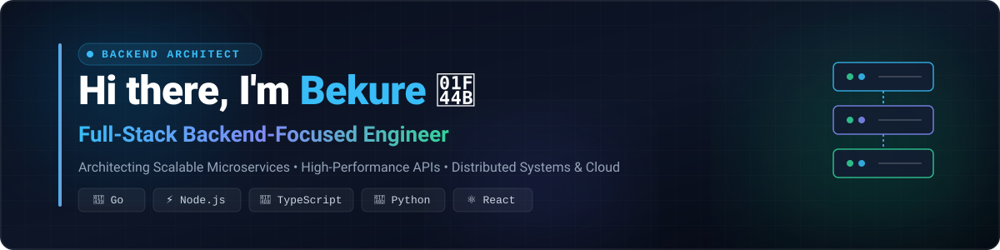

  <!-- Dynamic Self-Hosted SVG Header Banner -->
  

    

  <!-- Animated Typing Subtitle -->
  

  

    
    
    
    
  

---

### 👨‍💻 About Me

I am a passionate **Full-Stack Backend-Focused Developer** dedicated to engineering high-performance APIs, resilient backend microservices, and complete, end-to-end web applications. With deep focus on server-side architecture, concurrent computing with **Go (Golang)** & **Node.js**, database optimization, and clean data contracts, I bridge robust backends with seamless client experiences.

- 🚀 **Backend Mastery**: Building high-throughput microservices, RESTful & gRPC APIs, concurrent services in **Go** and **Node.js/TypeScript**, and real-time socket communication.
- 💻 **Full-Stack Execution**: Connecting scalable backends with modern **React**, **Next.js**, and **TypeScript** frontends.
- 🗄️ **Data & Performance**: Designing optimized schemas, caching layers, and database queries across both SQL (**PostgreSQL**, **MySQL**) and NoSQL (**MongoDB**, **Redis**).
- ⚙️ **Engineering Standards**: Committed to modular architecture, type safety, test-driven reliability, and CI/CD automation.
- 🌐 **Featured Work**: Explore my projects, case studies, and live demos at [bekure.bekurelabs.com](https://bekure.bekurelabs.com/).

---

### 🛠️ Technical Arsenal

<table width="100%">
  <tr>
    <td width="50%" valign="top">
      <h4>⚡ Backend & APIs</h4>
      

        
        
        
        
        
        
        
        
      

      <h4>🗄️ Databases & Caching</h4>
      

        
        
        
        
        
      

    </td>
    <td width="50%" valign="top">
      <h4>💻 Frontend & UI</h4>
      

        
        
        
        
        
        
      

      <h4>🚀 DevOps, Cloud & Tools</h4>
      

        
        
        
        
        
      

    </td>
  </tr>
</table>

---

### 🤝 Let's Connect & Collaborate

I am always excited to discuss backend systems, collaborate on ambitious fullstack projects, or explore new engineering opportunities.

- 💬 Let's talk about: **Backend architecture, Go microservices, database design, or fullstack solutions**
- 📬 Reach out directly: **[bekure27@gmail.com](mailto:bekure27@gmail.com)**
- 💼 Connect on LinkedIn: **[linkedin.com/in/bekure14](https://linkedin.com/in/bekure14)**
- 🌍 Explore Portfolio: **[bekure.bekurelabs.com](https://bekure.bekurelabs.com/)**

  

